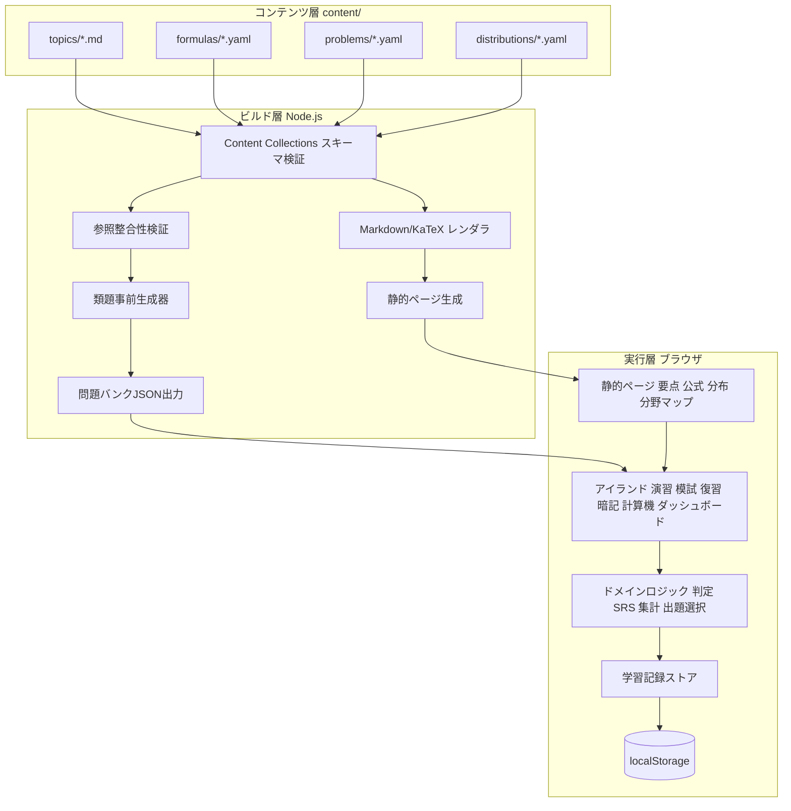
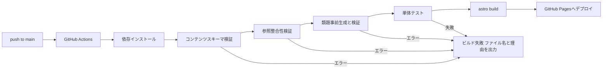
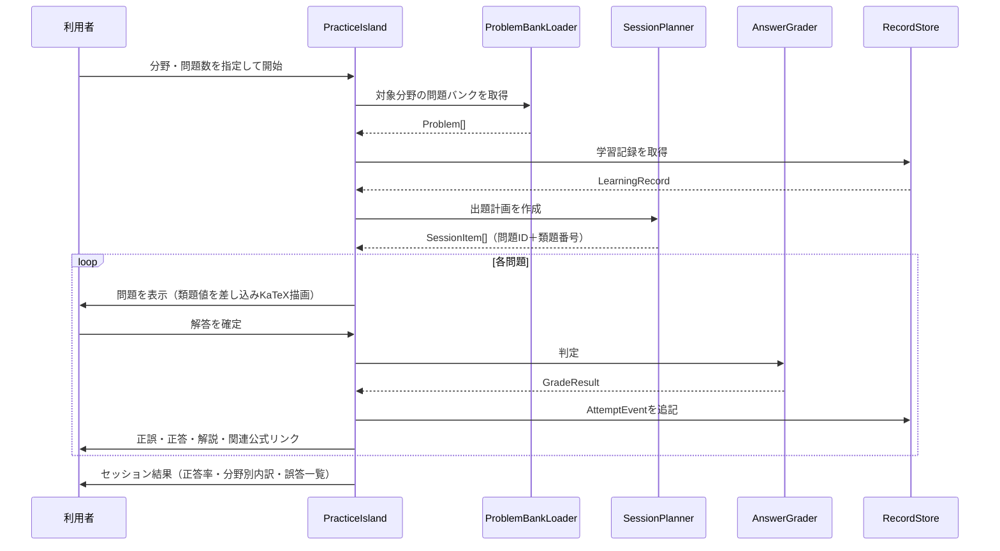
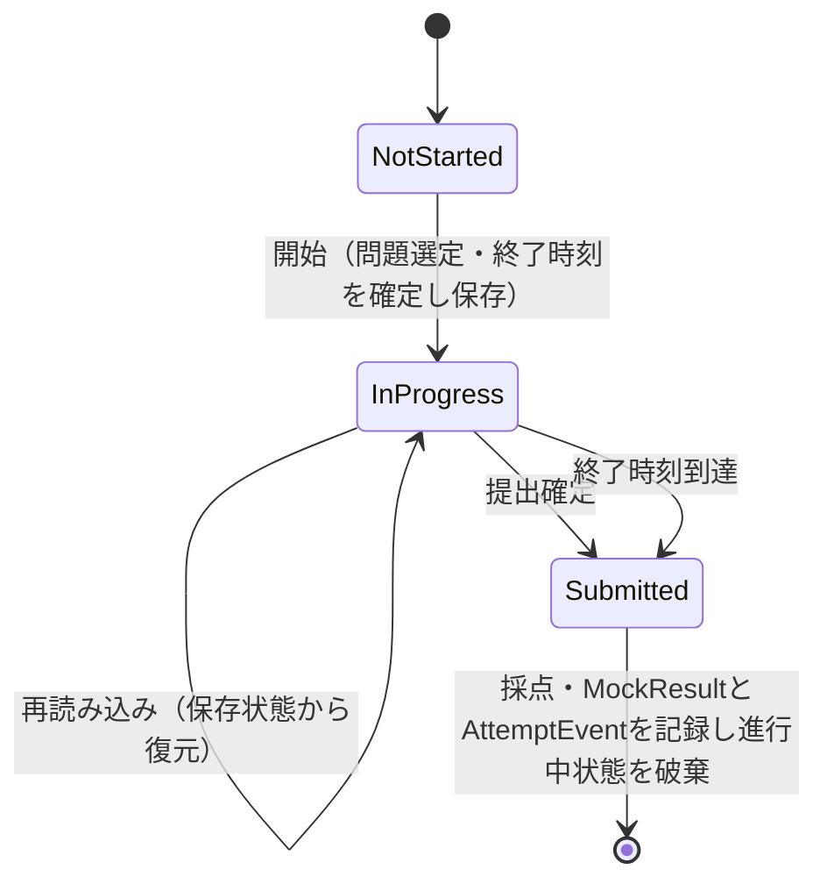
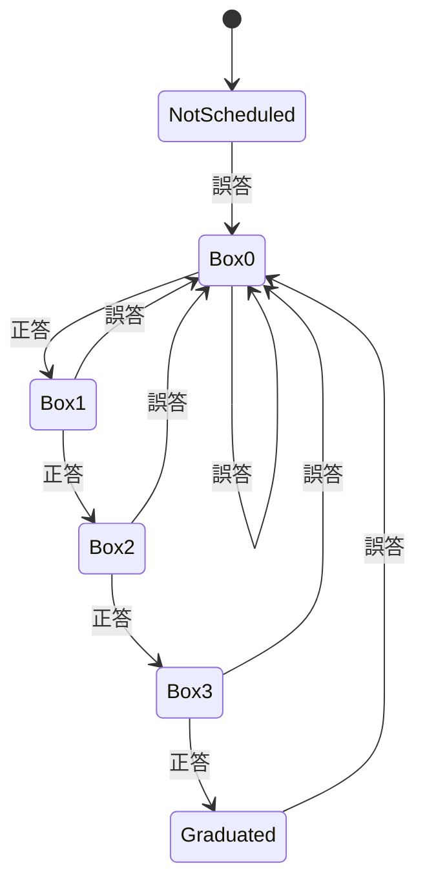
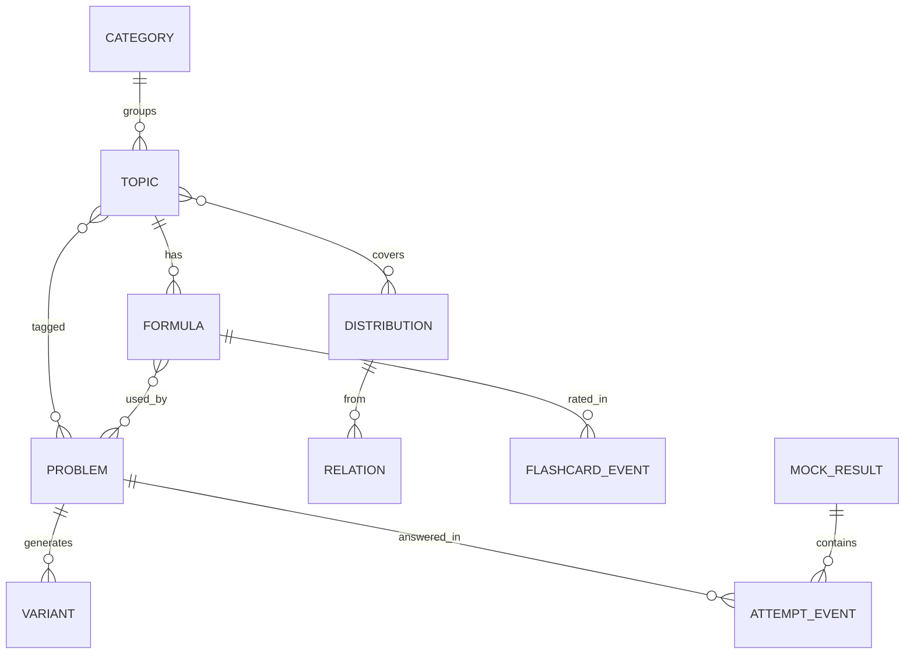

# Technical Design Document

## Overview

**Purpose**: 本機能は、統計検定準1級の受験者に対し、要点・公式・確率分布・演習・復習を相互リンクで結び付けた学習環境を、サーバー不要の静的Webアプリとして提供する。

**Users**: 受験者は、分野マップから要点を学び、公式カードと暗記カードで公式を定着させ、演習・模試で実力を測り、誤答を間隔反復で復習する。作成者は、Markdown/YAMLのコンテンツファイルを追加するだけで要点・公式・問題を拡充する。

**Impact**: 新規プロジェクト（グリーンフィールド）である。既存コード・ステアリング文書は存在しないため、本設計が技術スタックとディレクトリ構成の基準を定める。

### Goals
- 要点・公式・問題を分野IDと公式IDで相互参照し、誤答から根拠へ1クリックで戻れる導線を実現する
- 選択式・数値入力式（許容誤差判定）・パラメータ付き類題・模試・間隔反復をブラウザ内で完結させる
- コンテンツの追加をコード変更なしで行い、参照整合性と類題の計算可能性をビルド時に保証する
- GitHub Pagesのサブパス配下で、モバイル回線でも3秒以内に主要コンテンツを表示する

### Non-Goals
- ユーザーアカウント、サーバー側での学習記録の保存・端末間自動同期（JSONエクスポート／インポートで代替）
- 統計検定過去問題の収録
- コンテンツ編集用のGUI（作成者はテキストエディタとGitで編集する）
- オフライン動作（PWA/Service Worker）。将来拡張として残す
- 多言語対応（日本語のみ）

## Architecture

### High-Level Architecture

アプリは「ビルド時（Node.js）」と「実行時（ブラウザ）」の2層で構成する。ビルド時にコンテンツの検証・整形・類題の事前生成を完了させ、実行時は静的HTMLと、操作が必要な部分のみを担うインタラクティブ部品（アイランド）で動作する。



**Architecture Integration**:
- 新規コンポーネントの根拠: 静的ページ（閲覧系）とアイランド（操作系）を分けることで、閲覧ページはJavaScriptをほぼ送らずに高速表示し、操作が必要な画面のみ水和（hydration）する
- ドメインロジック（判定・SRS・集計・出題選択）はUIフレームワークに依存しない純粋なTypeScript関数として分離し、単体テストを容易にする
- ステアリング: 本設計確定後に `/kiro:steering` で `tech.md`・`structure.md` を生成し、本設計の技術選定とディレクトリ構成を反映する

### Technology Stack and Design Decisions

| 層 | 選定 | 理由 | 検討した代替 |
|---|---|---|---|
| サイト生成 | Astro 7.x | 静的出力が標準、Content Collectionsによる型付きスキーマ検証、アイランドアーキテクチャで閲覧ページのJSを最小化、`base` 設定でサブパス公開に対応 | VitePress（Vue前提で演習UIの自由度が低い）、Vite+React SPA（全ページJS依存で初期表示が遅い） |
| UIアイランド | Preact + `@preact/signals` | 軽量（約4KB）、Astro公式統合あり、シグナルで状態の局所再描画が容易 | React（バンドルが大きい）、Svelte（作成者の既存Preact経験を活かせない） |
| 言語 | TypeScript（strict） | コンテンツスキーマ・学習記録スキーマの型安全性 | JavaScript |
| 数式 | KaTeX | 高速・サーバーサイドレンダリング可能。静的ページはビルド時にHTML化、演習画面のみクライアントで描画 | MathJax（重い） |
| Markdown処理 | remark-math + rehype-katex（静的ページ）、独自rehypeプラグイン（問題テンプレート） | Astro標準のMarkdownパイプラインに統合可能 | MDX（作成者の記述負担が増える） |
| 確率分布計算 | `@stdlib/stats-base-dists-*`（個別パッケージ） | 保守が継続、分布ごとに個別インポートできバンドルが小さい、pdf/cdf/quantile/mean/variance/mgfを網羅 | jStat（保守が停滞）、自前実装（精度検証コストが高い） |
| 類題の式評価 | mathjs（ビルド時のみ使用） | 安全な式評価器（`eval` を使わない）、カスタム関数注入が可能。クライアントへは送らない | expr-eval（脆弱性報告あり）、クライアントでの評価（バンドル肥大・実行時エラーのリスク） |
| グラフ描画 | 自前のSVG描画コンポーネント（Preact） | 必要な描画は関数曲線・棒・領域塗りのみ。CSS変数でダークモード対応が容易、依存ゼロ | Chart.js / uPlot（Canvas主体でテーマ追従と数式ラベルが扱いにくい）、Observable Plot（d3依存で重い） |
| テスト | Vitest（単体・統合）、Playwright（E2E） | Viteベースで設定共有、Astro公式推奨 | Jest |
| CI/CD | GitHub Actions + `actions/deploy-pages` | GitHub Pages公式のデプロイ方式 | gh-pagesブランチへのpush |

#### Key Design Decisions

**Decision 1: 類題はビルド時に事前生成し、クライアントは生成済みインスタンスから選ぶ**
- **Context**: 要件7（類題生成）と要件13.5（ビルド時の計算可能性検証）を、静的サイトの制約下で両立させる必要がある
- **Alternatives**: (a) クライアントで式評価器を動かし毎回生成する、(b) 問題ごとにTypeScriptの生成関数を書く、(c) ビルド時に有限個のインスタンスを事前生成する
- **Selected Approach**: (c)。問題YAMLの `params`（範囲・刻み）、`constraints`（制約式）、`answer`（正答式）、`derived`（中間値式）をビルド時にmathjsで評価し、乱数シード固定で問題ごとに最大 `variants` 個（既定20）のパラメータ組と正答を生成して問題バンクJSONに格納する。テンプレート文中の `{{name}}` はクライアントで置換する
- **Rationale**: 式評価器をクライアントへ送らずに済み、正答計算の失敗はすべてビルドで検出できる。シード固定によりビルド結果が再現可能になる
- **Trade-offs**: 類題の種類は有限（既定20通り）になる。受験対策として十分な多様性であり、`variants` で問題ごとに調整できる

**Decision 2: 学習記録はイベントログを正とし、復習状態・集計は導出値とする**
- **Context**: 要件11.4のインポート時「統合」を矛盾なく実現し、要件9（SRS）・要件10（集計）を一貫させる必要がある
- **Alternatives**: (a) 復習スケジュールや正答率を状態として保存し都度更新する、(b) 解答・暗記評価・模試結果を追記専用のイベントとして保存し、状態は再計算する
- **Selected Approach**: (b)。保存するのは `AttemptEvent`（解答）、`FlashcardEvent`（暗記評価）、`MockResult`（模試結果）の3種のイベント配列のみ。各イベントは一意ID（UUID）を持つ。復習スケジュール・分野別正答率・暗記カード状態は、イベントを時系列順に再生する純粋関数で導出する
- **Rationale**: 統合はIDによる和集合と時刻順ソートだけで完結し、二重計上や状態の矛盾が起きない。SRSの規則を変更しても過去の記録から再計算できる
- **Trade-offs**: 起動時に毎回再計算が必要になる。想定規模（数千件）では数ミリ秒で完了するため問題にならない

**Decision 3: 静的ページはビルド時に数式をHTML化し、問題文のみクライアントで描画する**
- **Context**: 要件15.5（3秒以内の表示）と、類題の数値をクライアントで差し込む要件7を両立させる
- **Alternatives**: (a) 全ページをクライアントでKaTeX描画、(b) 全類題をビルド時に描画済みHTMLとして出力、(c) 静的ページはビルド時描画、問題は数式をLaTeX文字列のまま保持しクライアントで描画
- **Selected Approach**: (c)。要点・公式・分布ページはrehype-katexでHTML化してKaTeXのJSを送らない。問題バンクでは、Markdownをビルド時にHTMLへ変換しつつ数式部分のみ `<span data-tex="...">` として残し、クライアントで `{{name}}` を置換した後にKaTeXで描画する
- **Rationale**: 閲覧ページの初期表示が最速になり、KaTeXのJSは演習系画面でのみ遅延読込される。(b) は問題数×類題数でJSONが肥大化する
- **Trade-offs**: 問題文の描画ロジックがビルド側とクライアント側に分かれる。共通の変換仕様をテストで固定して整合を保つ

## System Flows

### ビルドとデプロイ



### 演習セッション（分野別／ランダム／復習）



### 模試モードの状態遷移



### 復習（間隔反復）の状態遷移



各ボックスの次回復習間隔は Box0=1日、Box1=3日、Box2=7日、Box3=14日とする。Box3で正答すると（誤答後4回連続正答）復習対象から外れる（Graduated）。間隔と卒業条件は `SRS_CONFIG` 定数で一元管理する。復習対象外の問題を通常演習で解いて正答しても状態は変わらない。

## Requirements Traceability

| 要件 | 概要 | 主なコンポーネント | 主なインターフェース／フロー |
|---|---|---|---|
| 1.1–1.5 | 分野マップ・共通ナビゲーション | TopicMapPage, SiteLayout, TopicStatsBadge（アイランド） | `ContentIndex.topicsByCategory`, `computeTopicStats` |
| 2.1–2.6 | 要点ページ | TopicPage, rehype-internal-links | `topics` コレクション, `[[topic:id]]` 記法 |
| 3.1–3.6 | 公式チートシート | FormulaListPage, FormulaFilterIsland, FormulaPage | `filterFormulas` |
| 4.1–4.5 | 暗記カード | FlashcardIsland | `deriveFlashcardStates`, `orderFlashcards`, `FlashcardEvent` |
| 5.1–5.5 | 分布ページ | DistributionPage, DistributionExplorerIsland, RelationDiagram | `DistributionRegistry`, `validateParams` |
| 6.1–6.10 | 演習 | PracticeIsland, SessionPlanner, AnswerGrader, ProblemRenderer | 演習セッションフロー |
| 7.1–7.5 | 類題 | VariantGenerator（ビルド）, ProblemRenderer | Decision 1, `instantiate` |
| 8.1–8.7 | 模試 | MockExamIsland, SessionPlanner, MockSessionStore | 模試状態遷移, `planMockExam` |
| 9.1–9.6 | 復習 | ReviewIsland, SrsScheduler | SRS状態遷移, `deriveReviewSchedule`, `dueItems` |
| 10.1–10.5 | ダッシュボード | DashboardIsland, StatsAggregator | `computeTopicStats`, `detectWeakTopics` |
| 11.1–11.8 | 学習記録の永続化 | RecordStore, RecordCodec, SettingsIsland | `RecordStore`, `mergeRecords`, Decision 2 |
| 12.1–12.5 | 分布計算機 | CalculatorIsland, DistributionRegistry, SvgPlot | `cdf`, `quantile` |
| 13.1–13.6 | コンテンツ管理 | Content Collections, ReferenceValidator, VariantGenerator | ビルドフロー |
| 14.1–14.4 | 静的公開 | astro.config（`base`）, deploy.yml, 404Page | ビルドとデプロイフロー |
| 15.1–15.5 | 表示品質 | SiteLayout, テーマトークン, KeyboardShortcuts | Performance節 |
| 16.1–16.3 | 著作権 | AboutPage, `source` フィールド, LICENSES | Security節 |

## Components and Interfaces

### コンテンツ層（ビルド時）

#### ContentSchemas（Astro Content Collections）

**Responsibility & Boundaries**
- **Primary Responsibility**: `content/` 配下の全ファイルを型付きスキーマ（Zod）で検証し、型付きデータとしてページ生成に供給する
- **Data Ownership**: topics / formulas / problems / distributions / categories の5コレクション

**Dependencies**
- **Inbound**: ReferenceValidator, VariantGenerator, 全静的ページ
- **External**: Astro Content Layer API（`glob` ローダー）、Zod

**Contract Definition**: Data Models節の論理モデルをZodスキーマとして定義する。必須項目欠落・型不一致はAstroがファイルパス付きでビルドエラーにする（要件13.3, 13.4）。

#### ReferenceValidator

**Responsibility & Boundaries**
- **Primary Responsibility**: コレクション横断の整合性（ID重複、存在しない分野ID・公式ID・分布ID・関連問題IDへの参照、要点本文中の `[[topic:id]]` / `[[formula:id]]` リンク先の存在）を検証する
- **Domain Boundary**: ビルド時の検証のみ。実行時には動作しない

**Dependencies**
- **Inbound**: `npm run validate`（CIおよび `prebuild`）
- **Outbound**: ContentSchemas の読込結果

**Contract Definition**
```typescript
interface ValidationIssue {
  file: string;
  field: string;
  message: string;
}

interface ReferenceValidator {
  validate(content: LoadedContent): ValidationIssue[];
}
```
- **Postconditions**: 戻り値が空配列でない場合、CLIは全件をファイル名・項目・理由の形式で出力し終了コード1で終了する

#### VariantGenerator

**Responsibility & Boundaries**
- **Primary Responsibility**: パラメータ定義を持つ問題から類題インスタンス（パラメータ値・中間値・正答）を事前生成し、計算可能性を検証する（要件7.1–7.3, 13.5）

**Dependencies**
- **Outbound**: mathjs（式評価）、`StatFunctions`（mathjsへ注入する分布関数群: `pnorm`, `qnorm`, `pt`, `qt`, `pchisq`, `qchisq`, `pf`, `qf`, `choose`, `gamma` 等。実体は `@stdlib`）
- **External**: mathjs（devDependency、クライアントへは含めない）

**Contract Definition**
```typescript
interface VariantGenerator {
  generate(problem: ProblemSource, seed: string): Result<ProblemVariant[], VariantError>;
}

type VariantError =
  | { kind: 'constraint-unsatisfiable'; problemId: string; tries: number }
  | { kind: 'evaluation-failed'; problemId: string; expression: string; message: string }
  | { kind: 'non-finite-answer'; problemId: string; params: Record<string, number> }
  | { kind: 'choice-collision'; problemId: string; params: Record<string, number> };
```
- **Preconditions**: `params` の各範囲が `min <= max`、`step > 0`
- **Postconditions**: 返す各類題は全制約式を満たし、正答は有限値である。選択式の場合、生成された選択肢の値が互いに重複しない
- **Invariants**: 同一の `(problem, seed)` に対し常に同一の結果を返す（シードは問題IDを用いる）
- **生成手順**: (1) 各パラメータを範囲・刻みから一様抽出、(2) `derived` を宣言順に評価、(3) `constraints` を評価し偽なら再抽出（最大1,000回、超過で `constraint-unsatisfiable`）、(4) `answer` を評価、(5) `choices[].value` 式を評価、(6) 表示用丸め（`display` 桁数）を適用、(7) パラメータ組の重複を除き `variants` 個に達するまで繰り返す（組合せが少ない場合は全組合せで打ち切る）

#### ContentRenderer

**Responsibility & Boundaries**
- **Primary Responsibility**: Markdownを、静的ページ用（数式をKaTeXでHTML化）と問題バンク用（数式を `<span class="tex" data-tex="...">` として保持し `{{name}}` を温存）の2モードでHTMLへ変換する。`[[topic:id]]` 等の内部リンク記法を `base` を考慮したURLへ解決する（要件2.6）

```typescript
type RenderMode = 'static' | 'template';

interface ContentRenderer {
  render(markdown: string, mode: RenderMode): string;
}
```

#### ProblemBankEmitter

**Responsibility & Boundaries**
- **Primary Responsibility**: 分野ごとの問題バンクJSON（`/data/problems/{topicId}.json`）と全体索引（`/data/problems/index.json`: 問題ID・分野ID・難易度・形式のみ）を静的エンドポイントとして出力する

**Contract Definition**: 出力形式は Data Models節の `ProblemBankFile` / `ProblemIndexFile`。各ファイルは `contentVersion`（コンテンツのハッシュ）を持つ。

### 表示層（静的ページ）

| ページ | パス | 責務 | 要件 |
|---|---|---|---|
| DashboardPage | `/` | DashboardIslandの配置 | 10 |
| TopicMapPage | `/topics/` | 大分類別の分野一覧、件数表示、正答率バッジ（アイランド） | 1 |
| TopicPage | `/topics/{id}/` | 要点本文、主要公式カード、関連問題一覧、「この分野を演習する」 | 2 |
| FormulaListPage | `/formulas/` | 公式一覧（静的HTMLで全件出力）＋FormulaFilterIsland | 3 |
| FormulaPage | `/formulas/{id}/` | 公式詳細、紐付く問題一覧 | 3.4, 3.5 |
| FlashcardPage | `/flashcards/` | FlashcardIsland | 4 |
| DistributionIndexPage | `/distributions/` | 分布一覧、RelationDiagram | 5.1, 5.5 |
| DistributionPage | `/distributions/{id}/` | 性質表（静的）＋DistributionExplorerIsland | 5.2–5.4 |
| PracticePage | `/practice/` | 演習条件の設定＋PracticeIsland。クエリ `?topic=` `?problem=` `?mode=random` で開始条件を受け取る | 6, 7 |
| MockExamPage | `/mock/` | MockExamIsland | 8 |
| ReviewPage | `/review/` | ReviewIsland | 9 |
| CalculatorPage | `/calculator/` | CalculatorIsland | 12 |
| SettingsPage | `/settings/` | エクスポート・インポート・全消去 | 11.3–11.6 |
| AboutPage | `/about/` | 非公式である旨、出典方針、ライセンス一覧 | 16 |
| NotFoundPage | `/404.html` | 分野マップへの導線 | 14.4 |

#### SiteLayout
- **Primary Responsibility**: 共通ヘッダー（ナビゲーション: ダッシュボード・分野マップ・公式・分布・演習・復習・計算機）、フッター（非公式表記、About・設定へのリンク）、テーマトークン、ストレージ利用不可時の警告バナー領域を提供する（要件1.5, 11.7, 15, 16.2）
- モバイル幅ではナビゲーションをハンバーガーメニューに折り畳む。`.katex-display` は `overflow-x: auto` とし、長い数式のみ横スクロールさせる

#### RelationDiagram
- **Primary Responsibility**: `distributions/*.yaml` の `relations`（関係種別・条件ラベル）と、`categories.yaml` に定義した手動配置座標から、分布関係図をビルド時にSVGとして生成する。各ノードは分布詳細ページへのリンクとする（要件5.5）

### 実行層（アイランド）

すべてのアイランドは Preact コンポーネントであり、`client:load`（演習系）または `client:visible`（ページ下部の補助表示）で水和する。アイランドはドメインロジックと RecordStore のみに依存し、相互に直接依存しない。

| アイランド | 責務 | 主な依存 |
|---|---|---|
| PracticeIsland | 演習・復習セッションの進行、解答入力、判定結果と解説の表示、セッション結果表示 | ProblemBankLoader, SessionPlanner, AnswerGrader, ProblemRenderer, RecordStore |
| MockExamIsland | 模試の開始・残り時間表示・問題一覧（未解答／マーク表示）・提出・採点結果表示 | 同上 + MockSessionStore |
| ReviewIsland | 当日の要復習問題数と次回予定日の表示、PracticeIslandを復習モードで起動 | SrsScheduler, RecordStore |
| FlashcardIsland | 範囲選択、カード提示・裏返し・評価、一巡後の集計 | FlashcardScheduler, RecordStore |
| FormulaFilterIsland | 検索・分野／タグ絞り込みにより、静的に出力された公式カード要素の表示・非表示を切り替える。0件時の表示とリセット | `filterFormulas` |
| DistributionExplorerIsland | パラメータ入力（スライダー＋数値）、検証、PDF/PMFとCDFの再描画 | DistributionRegistry, SvgPlot |
| CalculatorIsland | 分布・パラメータ・値／確率の入力、上側・下側確率と分位点の計算、領域塗りつぶし表示 | DistributionRegistry, SvgPlot |
| DashboardIsland | 総解答数・正答率・要復習数、分野別表、弱点強調、模試推移、空状態の案内 | StatsAggregator, SrsScheduler, RecordStore |
| TopicStatsBadge | 分野マップ上の正答率表示 | StatsAggregator, RecordStore |
| SettingsIsland | エクスポート・インポート（置換／統合の選択）・全消去（確認ダイアログ） | RecordStore, RecordCodec |

#### ProblemRenderer
- **Primary Responsibility**: 問題バンクのテンプレートHTMLに類題の値を差し込み、`data-tex` 要素をKaTeXで描画する（要件7.1, 7.5）。KaTeXは初回利用時に動的インポートする

```typescript
interface RenderedProblem {
  statementHtml: string;
  choices: { id: string; html: string }[] | null;
  explanationHtml: string;
  answerDisplay: string;
}

interface ProblemRenderer {
  render(problem: Problem, variantIndex: number | null): RenderedProblem;
}
```
- **Preconditions**: `problem.variants` が存在する場合 `variantIndex` は `0 <= variantIndex < variants.length`
- **Postconditions**: 出力に未置換の `{{name}}` が残らない（残った場合は開発時に例外、本番では空文字に置換しコンソール警告）

### ドメインロジック層（UI非依存の純粋関数）

#### AnswerGrader（要件6.5, 6.6）

```typescript
type UserAnswer =
  | { kind: 'choice'; choiceId: string }
  | { kind: 'numeric'; raw: string };

type GradeResult =
  | { status: 'graded'; correct: boolean; normalizedAnswer: string }
  | { status: 'invalid-input'; reason: 'not-a-number' | 'empty' };

interface AnswerGrader {
  grade(problem: Problem, variantIndex: number | null, answer: UserAnswer): GradeResult;
}
```
- 数値入力の正規化: 前後空白の除去、全角数字・全角マイナス・全角ピリオドの半角化、桁区切りカンマの除去、`1.2e-3` 形式と分数 `a/b` を受理する
- 許容誤差判定: `tolerance.type` が `absolute` の場合 `|x - a| <= tol`、`relative` の場合 `|x - a| <= tol * |a|`。既定は `absolute`、`tol` は表示桁数の半単位（例: 小数第3位まで表示なら0.0005）とし、問題ごとに上書きできる

#### SessionPlanner（要件6.1, 6.2, 8.1, 9.5）

```typescript
type SessionMode =
  | { kind: 'topic'; topicIds: string[]; count: number }
  | { kind: 'random'; topicIds: string[] | 'all'; count: number }
  | { kind: 'single'; problemId: string }
  | { kind: 'review'; asOf: Date }
  | { kind: 'mock'; config: MockConfig };

interface SessionItem {
  problemId: string;
  variantIndex: number | null;
}

interface SessionPlanner {
  plan(mode: SessionMode, bank: ProblemIndex, record: DerivedRecord, rng: Rng): SessionItem[];
}
```
- **topic / random**: 対象から重複なしで無作為抽出する。対象数が `count` 未満なら全問を出題する。未解答の問題を優先して抽出する
- **review**: `SrsScheduler.dueItems(asOf)` の結果を、復習予定日が古い順に並べる
- **mock**: 大分類ごとに `MockConfig.categoryWeights` に比例して問題数を割り当て（最大剰余法）、各大分類内で無作為抽出する。不足分は他大分類から補う
- **類題番号**: 類題を持つ問題は、その問題で直近に使った類題番号を避けて無作為に選ぶ

#### SrsScheduler（要件9.1–9.6）

```typescript
interface SrsConfig {
  intervalsDays: readonly [number, number, number, number]; // [1, 3, 7, 14]
  graduateAfterBox: number; // 3
}

type ReviewState =
  | { status: 'graduated'; graduatedAt: string }
  | { status: 'scheduled'; box: 0 | 1 | 2 | 3; dueDate: string }; // dueDate は YYYY-MM-DD（ローカル日付）

interface SrsScheduler {
  deriveReviewSchedule(attempts: readonly AttemptEvent[], config: SrsConfig): Map<string, ReviewState>;
  dueItems(schedule: Map<string, ReviewState>, asOf: Date): { problemId: string; dueDate: string }[];
  nextDueDate(schedule: Map<string, ReviewState>, asOf: Date): string | null;
}
```
- **Invariants**: 一度も誤答していない問題はスケジュールに現れない。日付は利用者のローカルタイムゾーンの暦日で比較する
- 模試中の解答も模試採点時に `AttemptEvent`（`context: 'mock'`）として記録し、SRSの対象とする

#### FlashcardScheduler（要件4.3–4.5）

```typescript
type FlashcardRating = 'known' | 'unsure';

interface FlashcardScheduler {
  deriveStates(events: readonly FlashcardEvent[]): Map<string, { rating: FlashcardRating; ratedAt: string }>;
  order(formulaIds: readonly string[], states: Map<string, { rating: FlashcardRating; ratedAt: string }>, rng: Rng): string[];
}
```
- 並び順: 「あいまい」→ 未評価 → 「覚えた」（評価が古い順）の3群とし、各群内は無作為に並べる

#### StatsAggregator（要件1.4, 10.1–10.4, 11.8）

```typescript
interface TopicStats {
  topicId: string;
  attempts: number;
  correct: number;
  accuracy: number | null; // attempts=0 のとき null
}

interface WeakTopicCriteria {
  minAttempts: number;   // 10
  maxAccuracy: number;   // 0.6（未満を弱点とする）
}

interface StatsAggregator {
  computeTopicStats(attempts: readonly AttemptEvent[], index: ProblemIndex): Map<string, TopicStats>;
  detectWeakTopics(stats: Map<string, TopicStats>, criteria: WeakTopicCriteria): string[];
  overall(attempts: readonly AttemptEvent[], index: ProblemIndex): { attempts: number; accuracy: number | null };
}
```
- 1つの問題が複数分野に属する場合、各分野に1件ずつ計上する
- 現在の問題索引に存在しない問題IDの記録は集計から除外する（要件11.8）

#### DistributionRegistry（要件5, 12）

```typescript
type DistributionKind = 'discrete' | 'continuous';

interface ParamSpec {
  name: string;
  label: string;          // LaTeX
  min: number;
  max: number;
  minInclusive: boolean;
  maxInclusive: boolean;
  integer: boolean;
  default: number;
}

interface DistributionDef {
  id: string;
  kind: DistributionKind;
  params: readonly ParamSpec[];
  support(params: Record<string, number>): { min: number; max: number };
  density(x: number, params: Record<string, number>): number; // PMF または PDF
  cdf(x: number, params: Record<string, number>): number;
  quantile(p: number, params: Record<string, number>): number;
}

type ParamValidation =
  | { ok: true }
  | { ok: false; errors: { param: string; message: string }[] };

interface DistributionRegistry {
  get(id: string): DistributionDef | undefined;
  validateParams(def: DistributionDef, params: Record<string, number>): ParamValidation;
}
```
- 計算機は `normal`, `t`, `chisq`, `f` の4分布を対象とする（要件12.1）。分布ページは Data Models節のカタログに定義した全分布を対象とする
- 表示精度: 確率・分位点は有効数字6桁で表示し、小数点以下4桁以上を保証する（要件12.5）。極端な裾確率（1e-4未満）は指数表記とする

#### SvgPlot
- **Primary Responsibility**: 連続関数の折れ線、離散値の棒（ステム）、指定区間の塗りつぶし、軸・目盛を描画するPreactコンポーネント。色はCSS変数を参照しダークモードに追従する
- 連続関数は表示区間を400点でサンプリングし、密度が無限大となる点（例: ガンマ分布 shape<1 の原点）は描画範囲上限でクリップする

### 永続化層

#### RecordStore（要件11.1, 11.2, 11.7）

```typescript
interface LearningRecord {
  schemaVersion: 1;
  attempts: AttemptEvent[];
  flashcards: FlashcardEvent[];
  mockResults: MockResult[];
}

type StorageStatus = 'available' | 'unavailable' | 'quota-exceeded';

interface RecordStore {
  readonly status: StorageStatus;
  load(): LearningRecord;
  appendAttempts(events: readonly AttemptEvent[]): void;
  appendFlashcard(event: FlashcardEvent): void;
  appendMockResult(result: MockResult): void;
  replace(record: LearningRecord): void;
  clear(): void;
  subscribe(listener: (record: LearningRecord) => void): () => void;
}
```
- **Persistence**: キー `stats-pre1:record` に `LearningRecord` をJSONで保存する。追記ごとに全体を書き込む
- **Concurrency**: 別タブでの更新は `storage` イベントで検知して再読込し、購読者へ通知する。追記操作は書き込み直前に最新値を読み直してからマージするため、タブ間でイベントが失われない
- **Degradation**: `localStorage` へのアクセスで例外が発生した場合 `status='unavailable'` としメモリ上でのみ保持する。書き込み時の容量超過は `status='quota-exceeded'` とし、SiteLayoutの警告バナーにエクスポートを促す文言を表示する

#### RecordCodec（要件11.3–11.5）

```typescript
interface ExportFile {
  app: 'stats-pre1-study-app';
  schemaVersion: number;
  exportedAt: string;
  record: LearningRecord;
}

type DecodeError =
  | { kind: 'not-json' }
  | { kind: 'wrong-app' }
  | { kind: 'unsupported-version'; version: number }
  | { kind: 'schema-mismatch'; path: string; message: string };

interface RecordCodec {
  encode(record: LearningRecord, now: Date): ExportFile;
  decode(text: string): Result<LearningRecord, DecodeError>;
  merge(a: LearningRecord, b: LearningRecord): LearningRecord;
  migrate(raw: unknown): Result<LearningRecord, DecodeError>;
}
```
- `merge` は各イベント配列をIDで和集合とし、時刻順に整列する（Decision 2）
- `decode` は検証完了まで既存記録に一切触れない。置換・統合の反映は検証成功後にのみ行う
- `migrate` は将来の `schemaVersion` 変更時に旧形式を現行形式へ変換する。ストア読込時とインポート時の両方で使用する

#### MockSessionStore（要件8.7）
- 進行中の模試を、キー `stats-pre1:mock-session` に `MockSession` として保存する。解答・マーク・現在位置の変更ごとに保存する
- 残り時間は保存した `endsAt`（絶対時刻）から算出するため、再読み込みやタブを閉じていた時間も経過時間に含まれる。復元時に `endsAt` を過ぎていれば即座に採点する
- 進行中の模試は学習記録のエクスポート対象に含めない

## Data Models

### Domain Model



**ビジネスルールと不変条件**
- 分野・公式・問題・分布のIDは各コレクション内で一意であり、`[a-z0-9-]+` 形式とする。IDはURLと学習記録のキーを兼ねるため、公開後に変更しない（変更が必要な場合は `aliases` に旧IDを残す）
- 問題は1つ以上の分野に属する。公式は1つの主分野に属する
- 選択式の問題は正答の選択肢をちょうど1つ持つ
- 学習記録のイベントは追記のみとし、更新・個別削除は行わない（全消去のみ許可）

### Logical Data Model（コンテンツ）

#### カテゴリと分野
```typescript
interface Category {          // content/categories.yaml
  id: string;                 // 例: 'probability', 'inference', 'regression', 'multivariate', 'timeseries', 'bayes', 'other-methods'
  title: string;
  order: number;
}

interface Topic {             // content/topics/{id}.md の frontmatter
  id: string;
  title: string;
  category: string;           // Category.id
  order: number;
  summary: string;
  distributions?: string[];   // Distribution.id
  // 本文は「## 定義」「## 主要公式」「## 導出の流れ」「## 落とし穴」の見出し構成とする。
  // 「関連問題」はページ側で自動生成する
}
```

初期の大分類と分野（準1級の出題範囲に基づく。分野は作成者が追加できる）:

| 大分類 | 分野の例 |
|---|---|
| 確率と分布 | 確率の基礎・条件付き確率、確率変数と期待値、離散分布、連続分布、多変量分布・変数変換、極限定理 |
| 統計的推測 | 点推定・最尤法、区間推定、仮説検定の枠組み、検定の各論（平均・分散・比率・適合度・独立性）、尤度比検定・漸近論、ノンパラメトリック検定、多重比較 |
| 回帰と線形モデル | 単回帰・重回帰、回帰診断、モデル選択（AIC/BIC/交差検証）、分散分析・実験計画、一般化線形モデル（ロジスティック・ポアソン） |
| 多変量解析 | 主成分分析、因子分析、判別分析、クラスター分析、多次元尺度法 |
| 時系列 | 定常性・自己相関、AR/MA/ARMA、単位根・ARIMA、状態空間モデル |
| ベイズと計算統計 | ベイズ推定・共役事前分布、MCMC、ブートストラップ、EMアルゴリズム |
| その他の手法 | 分割表・カテゴリカルデータ、生存時間解析、欠測データ、標本調査、機械学習の基礎、因果推論の基礎 |

#### 公式カード
```typescript
interface Formula {           // content/formulas/{topicId}.yaml（1ファイルに複数カード）
  id: string;
  topic: string;              // Topic.id
  title: string;              // 暗記カードの問い面
  body: string;               // LaTeX（ディスプレイ数式）
  variables?: { symbol: string; meaning: string }[];
  conditions?: string;        // 適用条件（Markdown）
  derivation?: string;        // 導出の要点（Markdown）
  pitfalls?: string;          // 注意点（Markdown）
  tags: string[];
}
```

#### 問題
```typescript
type NumericExpr = string;    // mathjs 式。params・derived の名前と StatFunctions を参照できる

interface ProblemSource {     // content/problems/{topicId}/{id}.yaml
  id: string;
  topics: string[];           // 1件以上
  formulas: string[];
  difficulty: 1 | 2 | 3;
  type: 'choice' | 'numeric';
  source: { kind: 'original' } | { kind: 'reference'; exam: string; question: string };
  statement: string;          // Markdown + LaTeX + {{name}}
  explanation: string;        // Markdown + LaTeX + {{name}}
  params?: Record<string, { min: number; max: number; step: number }>;
  derived?: Record<string, NumericExpr>;      // 宣言順に評価
  constraints?: NumericExpr[];                // 真偽値を返す式
  variants?: number;                          // 既定20、上限50
  answer: NumericExpr | number;               // numeric の正答、または choice での参照値
  display?: { digits: number };               // 正答・派生値の表示桁数
  tolerance?: { type: 'absolute' | 'relative'; value: number };
  choices?: {                                 // type='choice' のとき必須
    id: string;                               // 'a'..'e'
    text: string;                             // Markdown + {{name}}。式由来の値は derived 経由で参照
    correct: boolean;
  }[];
  shuffleChoices?: boolean;                   // 既定 true
}
```

#### 問題バンク（ビルド出力、クライアントが読む形式）
```typescript
interface ProblemVariant {
  values: Record<string, string>;   // params + derived + answer を表示用に整形した文字列
  answer: number;                   // 判定用の正答（numeric）
}

interface Problem {
  id: string;
  topics: string[];
  formulas: string[];
  difficulty: 1 | 2 | 3;
  type: 'choice' | 'numeric';
  statementHtml: string;            // ContentRenderer 'template' モード
  explanationHtml: string;
  choices: { id: string; html: string; correct: boolean }[] | null;
  shuffleChoices: boolean;
  answer: number | null;            // 類題なし numeric の正答
  tolerance: { type: 'absolute' | 'relative'; value: number } | null;
  variants: ProblemVariant[] | null;
  sourceLabel: string;              // 'オリジナル' または 'YYYY年 問N 類題'
}

interface ProblemBankFile {
  contentVersion: string;
  topicId: string;
  problems: Problem[];
}

interface ProblemIndexEntry {
  id: string;
  topics: string[];
  category: string;
  type: 'choice' | 'numeric';
  difficulty: 1 | 2 | 3;
}

interface ProblemIndexFile {
  contentVersion: string;
  problems: ProblemIndexEntry[];
}
```

#### 分布カタログ
```typescript
interface DistributionSource {      // content/distributions/{id}.yaml
  id: string;                       // 'bernoulli','binomial','poisson','geometric','negative-binomial','hypergeometric',
                                    // 'uniform','normal','exponential','gamma','beta','chisq','t','f','lognormal',
                                    // 'cauchy','weibull','multinomial'（表のみ）,'multivariate-normal'（表のみ）
  title: string;
  kind: 'discrete' | 'continuous';
  interactive: boolean;             // false の分布は性質表のみ表示
  pmfOrPdf: string;                 // LaTeX
  cdf?: string;
  mean: string;
  variance: string;
  mgf?: string;                     // 存在しない場合は省略し「存在しない」と表示
  paramsDoc: { symbol: string; meaning: string; range: string }[];
  relations: { to: string; kind: 'special-case' | 'limit' | 'transform' | 'sum' | 'conjugate'; label: string }[];
  diagramPosition: { x: number; y: number };
}
```
数値計算の実体（`DistributionDef`）はコード側の `src/lib/distributions/` に分布IDごとに実装し、カタログの `interactive: true` の分布はビルド時に対応する実装の存在を検証する。

### Physical Data Model（学習記録 / localStorage）

```typescript
interface AttemptEvent {
  id: string;                       // UUID v4
  problemId: string;
  variantIndex: number | null;
  answeredAt: string;               // ISO 8601（タイムゾーン付き）
  correct: boolean;
  answer: string;                   // 選択肢IDまたは正規化済み数値文字列
  durationMs: number;
  context: 'practice' | 'review' | 'mock';
  mockId?: string;
}

interface FlashcardEvent {
  id: string;
  formulaId: string;
  rating: 'known' | 'unsure';
  ratedAt: string;
}

interface MockResult {
  id: string;
  startedAt: string;
  submittedAt: string;
  reason: 'submitted' | 'timeout';
  config: MockConfig;
  score: number;                    // 100点満点換算
  correct: number;
  total: number;
  byCategory: Record<string, { correct: number; total: number }>;
}

interface MockConfig {
  questionCount: number;            // 既定 30
  timeLimitMinutes: number;         // 既定 120
  categoryWeights: Record<string, number>;
}

interface MockSession {
  id: string;
  config: MockConfig;
  startedAt: string;
  endsAt: string;
  items: SessionItem[];
  choiceOrders: Record<string, string[]>;   // 選択肢シャッフル順を固定
  answers: Record<number, UserAnswer>;
  marked: number[];
  currentIndex: number;
  durations: Record<number, number>;
}
```

| キー | 値 | エクスポート対象 |
|---|---|---|
| `stats-pre1:record` | `LearningRecord` | 対象 |
| `stats-pre1:mock-session` | `MockSession` | 対象外 |
| `stats-pre1:prefs` | 直近の演習条件・暗記範囲などの表示設定 | 対象外 |

**容量見積り**: `AttemptEvent` 1件は約250バイトである。5,000件で約1.25MBとなり、一般的なlocalStorage上限（約5MB）内に収まる。

模試の既定値（30問・120分）は、第三者の受験情報サイトに掲載された準1級CBTの形式（25〜30問・120分、5肢選択と数値入力）に基づく。実装時に公式サイトで確認し、`MockConfig` の既定値として設定する。

## Error Handling

### Error Strategy
ビルド時に検出できる誤りはすべてビルド時に検出してデプロイを止める。実行時は利用者の入力誤りを項目単位で即時に示し、ストレージや通信の障害は学習記録以外の機能を止めずに縮退する。

### Error Categories and Responses

| 区分 | 事象 | 対応 | 要件 |
|---|---|---|---|
| ビルド | スキーマ違反・ID重複・参照切れ | ファイル名・項目・理由を出力しビルド失敗 | 13.3, 13.4 |
| ビルド | 類題の制約充足不能・式評価失敗・非有限値・選択肢値の重複 | 問題IDと式・パラメータ値を出力しビルド失敗 | 13.5 |
| ビルド | 未置換になる `{{name}}`（params/derived に存在しない名前） | 問題IDと名前を出力しビルド失敗 | 7.1 |
| 利用者入力 | 数値入力が空・非数値 | 解答を確定せず入力欄の下に理由を表示 | 6.6 |
| 利用者入力 | 分布パラメータ・確率が範囲外 | 計算・再描画を行わず有効範囲を表示 | 5.4, 12.4 |
| 利用者入力 | 不正なインポートファイル | 既存記録を変更せず `DecodeError` に応じた文言を表示 | 11.5 |
| 利用者入力 | 存在しないURL | 404ページで分野マップへ誘導 | 14.4 |
| 利用者入力 | クエリで指定した分野ID・問題IDが存在しない | 演習設定画面を表示し、指定が無効である旨を通知 | 6.1 |
| 実行環境 | localStorage 利用不可・容量超過 | 警告バナー表示、メモリ上で継続、エクスポートを促す | 11.7 |
| 実行環境 | 問題バンクJSONの取得失敗 | 再試行ボタン付きのエラー表示。閲覧系ページは影響を受けない | 6 |
| データ | 学習記録が現在のコンテンツに存在しないIDを参照 | 集計・出題計画から除外して継続 | 11.8 |
| データ | 保存済み記録が破損（JSON不正・スキーマ不一致） | 破損データを `stats-pre1:record.corrupt-{日時}` に退避し、空の記録で起動して通知 | 11.2 |
| データ | 問題バンクの `contentVersion` 変更により模試中の問題が消失 | 該当問題を採点対象から除き、結果画面で注記 | 8.7 |

### Monitoring
外部の監視サービスは使用しない。ビルドログ（GitHub Actions）を唯一の監視対象とし、実行時の想定外エラーはアイランドごとのエラーバウンダリで捕捉して「この部品を再読み込み」を表示し、詳細をブラウザコンソールに出力する。

## Testing Strategy

### Unit Tests（Vitest）
- **AnswerGrader**: 全角入力・カンマ・指数表記・分数の正規化、絶対／相対許容誤差の境界値、空・非数値の `invalid-input`
- **SrsScheduler**: 誤答→Box0、連続正答による昇格と間隔、再誤答によるBox0への戻り、Box3正答での卒業、卒業後の誤答による再登録、ローカル日付境界（23:59と0:00）
- **SessionPlanner**: 出題数が対象数を超える場合、未解答優先、模試の大分類比例配分（最大剰余法）と不足時の補充、直近類題番号の回避
- **RecordCodec**: `merge` の冪等性（`merge(a,a)=a`）と交換性、不正ファイル各種の `DecodeError`、`migrate`
- **VariantGenerator**: シード固定時の再現性、制約充足不能の検出、非有限値の検出、選択肢値の重複検出、組合せ数が `variants` 未満の場合の打ち切り
- **DistributionRegistry**: 各分布の `cdf(quantile(p)) ≈ p`、代表値の数表との一致（例: `qnorm(0.975)=1.959964`、`qt(0.975, 10)=2.228139`、`qchisq(0.95, 5)=11.0705`）、パラメータ検証の境界

### Integration Tests（Vitest）
- **コンテンツ検証パイプライン**: 不正なフィクスチャ（ID重複、参照切れ、未定義の `{{name}}`）でビルド検証が失敗し、ファイル名と理由が出力されること
- **ContentRenderer**: `template` モードで `{{name}}` と `data-tex` が保持され、ProblemRenderer で置換・描画した結果に未置換記号が残らないこと
- **RecordStore + StatsAggregator + SrsScheduler**: 演習イベントを追記した後、ダッシュボード集計と要復習数が期待値と一致すること
- **RecordStore のタブ間同期**: 2つのストアインスタンスで交互に追記してもイベントが失われないこと

### E2E Tests（Playwright、`base` 付きのビルド成果物をプレビューサーバーで配信）
- 分野マップ → 要点ページ → 「この分野を演習する」 → 数値入力で解答 → 解説から公式ページへ遷移
- 誤答 → 翌日の日付に時計を進める → 復習ページに要復習1件が表示され、出題される
- 模試開始 → 数問解答・マーク → 再読み込み → 残り時間と解答が保持 → 時計を進めて時間切れで自動採点
- エクスポート → 全消去 → インポート（置換）で学習記録が復元され、統合で重複しないこと
- スマートフォン相当の画面幅で、全主要ページに横スクロールが発生しないこと

### Performance
- Lighthouse CI（モバイル設定）で分野マップ・要点ページ・演習ページを計測し、LCP 3秒以内を継続的に確認する

## Security Considerations

- **XSS**: コンテンツは作成者のみが編集する信頼済み入力だが、学習記録のインポートは外部入力である。インポートデータは表示時にHTMLとして解釈せず、IDは既存コンテンツとの照合にのみ使用する。Preactの通常のテキスト描画のみを用い、`dangerouslySetInnerHTML` はビルド時生成の問題HTMLとKaTeX出力に限定する
- **式評価**: mathjs はビルド時のみ使用し、利用可能な関数を数学関数と `StatFunctions` に限定する（`import`・`createUnit`・`evaluate` の再帰呼び出し等を無効化）
- **外部リソース**: フォント・ライブラリはすべてビルド成果物に同梱し、実行時に外部CDNへアクセスしない
- **プライバシー**: 学習記録は利用者のブラウザ外へ送信しない。アクセス解析ツールは導入しない
- **著作権（要件16）**: 問題の `source` フィールドを必須とし、`reference` の場合は年度・問番号のみを保持して問題文の転載を禁止する運用規約を `CONTRIBUTING.md` に記載する。全ページのフッターに非公式である旨を表示し、About ページに依存ライブラリのライセンス一覧（ビルド時に `license-checker` 相当で生成）を掲載する

## Performance & Scalability

- **目標**: モバイル回線相当（Lighthouse モバイル設定）で主要ページの LCP 3秒以内（要件15.5）
- **静的ページ**: 数式はビルド時にHTML化し、KaTeXのJSを送らない。KaTeX CSSとフォントのみを読み込み、フォントは `font-display: swap` とする
- **アイランド**: 演習系アイランドのみ `client:load`、ダッシュボードの補助グラフ等は `client:visible` とする。KaTeX・分布計算モジュールは動的インポートで初回利用時に読み込む
- **問題バンク**: 分野ごとに分割し、演習対象の分野のみ取得する。ランダム演習・模試では索引で出題を決めた後、必要な分野ファイルのみ取得する。`contentVersion` をクエリに付与してキャッシュを制御する
- **規模の想定**: 分野約40、公式約400、問題約600（類題込みで約1万インスタンス）。分野ごとの問題バンクは1ファイル数十KB程度に収まる
- **ディレクトリ構成**:

```
statistics_certification/
├── astro.config.mjs            # site / base 設定、Preact・Markdown統合
├── content/
│   ├── categories.yaml
│   ├── topics/*.md
│   ├── formulas/*.yaml
│   ├── problems/{topicId}/*.yaml
│   └── distributions/*.yaml
├── src/
│   ├── content.config.ts       # Content Collections スキーマ
│   ├── pages/                  # 静的ページ・問題バンクJSONエンドポイント
│   ├── layouts/
│   ├── components/             # 静的コンポーネント（.astro）
│   ├── islands/                # Preact アイランド
│   ├── lib/
│   │   ├── domain/             # AnswerGrader, SessionPlanner, SrsScheduler, StatsAggregator, FlashcardScheduler
│   │   ├── distributions/      # DistributionRegistry と各分布実装
│   │   ├── storage/            # RecordStore, RecordCodec, MockSessionStore
│   │   └── render/             # ProblemRenderer
│   └── styles/                 # テーマトークン（ライト／ダーク）
├── build/                      # ReferenceValidator, VariantGenerator, ContentRenderer, ProblemBankEmitter, StatFunctions
├── tests/
│   ├── unit/
│   ├── integration/
│   └── e2e/
└── .github/workflows/deploy.yml
```

## 実装時の設計変更（2026-10-09）

実装中に判明した制約に合わせて、以下を変更した。

| 項目 | 当初の設計 | 実装 | 理由 |
|---|---|---|---|
| コンテンツの読込・検証 | Astro Content Collections | 独自ローダー（`build/content/`）＋ Zod | 検証 CLI・単体テストを Astro に依存せず実行するため。ページは `src/site.ts` の `getSite()` 経由で検証済みデータを使う |
| 分布関数 | `@stdlib/stats-base-dists-*` を直接 import | 必要な関数だけを esbuild で1ファイルにまとめた `src/vendor/stdlib.js` を同梱（`npm run vendor` で再生成） | @stdlib は1関数あたり数百ファイルに分かれ、WSL の `/mnt` 配下では1パッケージの読込に約20秒かかったため |
| 式評価（mathjs） | ESM 版 | 単一ファイル版 `mathjs/lib/browser/math.js` | 同上（ESM 版は読込に約55秒） |
| 類題 | パラメータなしの問題は `variants: null` | 全問題が1件以上の類題インスタンスを持つ（パラメータなしは固定インスタンス1件）。`AttemptEvent.variantIndex` は常に数値 | 描画・判定・出題計画の分岐をなくすため |
| 分野 | 全分野に本文必須 | `draft: true` の分野は必須見出しの検査を省略し「要点は準備中」と表示 | 出題範囲全体を分野マップに載せつつ、本文を段階的に書くため |
| 大分類 | 模試の重みは `MockConfig` のみ | `categories.yaml` の `mockWeight` を模試の大分類比率に使う | 作成者がコード変更なしで比率を調整できるようにするため |
| 復習 | 正答で昇格 | 期日以降の正答でのみ昇格（期日前の正答では変化なし） | 同じ日に繰り返し解いて卒業するのを防ぐため |
| 模試の記録 | 全問を記録 | 解答した問題のみ `AttemptEvent` を記録（未解答は得点上は不正解） | 未解答を誤答として集計すると分野別正答率が歪むため |
| 数値入力の許容誤差 | 表示桁の半単位 | 表示桁の指定がない問題は相対誤差 0.1% | 桁指定のない問題にも既定値が必要なため |
| E2E の配信 | `astro preview` | `scripts/serve-dist.mjs`（サブパス配下で `dist/` を配信し、404 に `404.html` を返す） | `astro preview` が同環境で30秒以内に起動しなかったため |
| 復習ページ | 専用の ReviewIsland | 演習アイランドを `mode="review"` で再利用 | 出題・判定・解説の UI を共通化するため |
